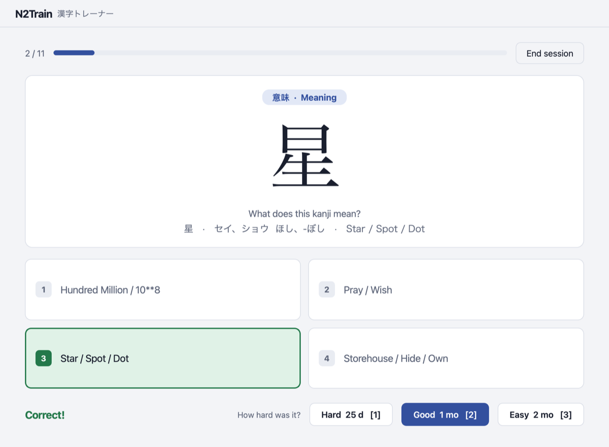
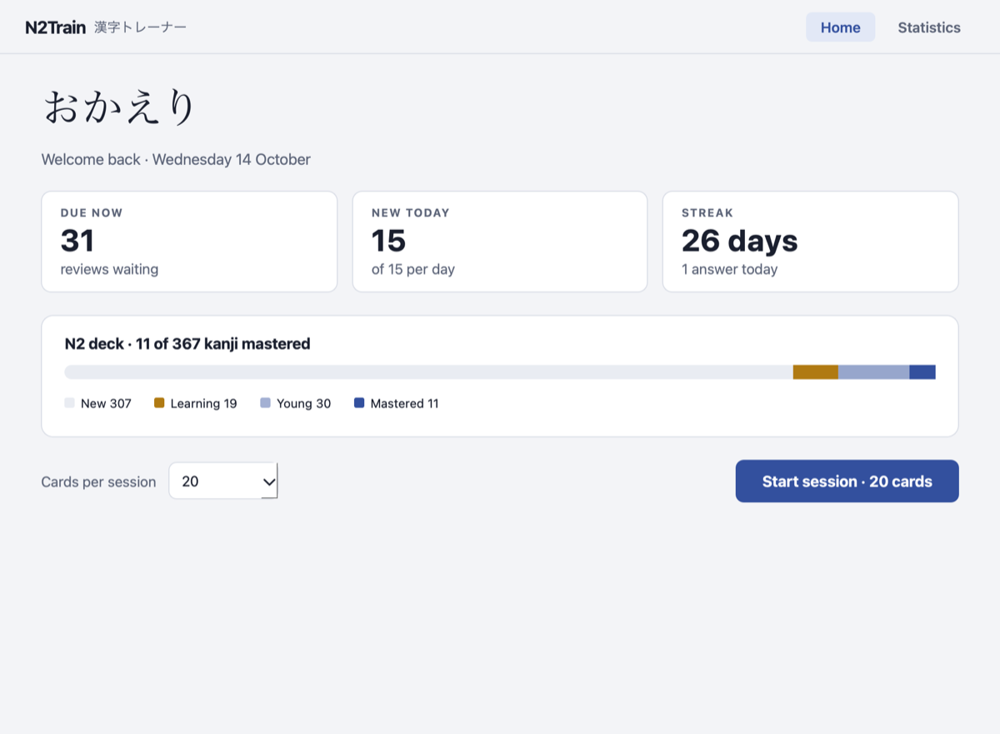
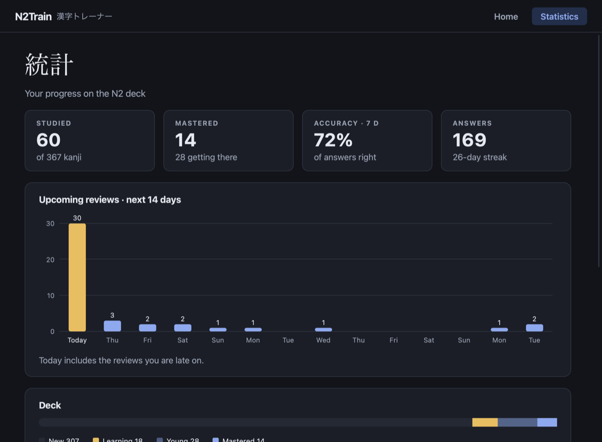

# N2Train

A desktop app to learn the ~370 kanji of the JLPT N2, scheduled by
[FSRS](https://github.com/open-spaced-repetition/fsrs4anki/wiki/ABC-of-FSRS),
the spaced repetition algorithm used by Anki.



Each kanji is asked as a multiple-choice question. FSRS models how well you
remember it and brings it back right before you would forget it: kanji you
know well come back in weeks, kanji you miss come back within minutes.

## Features

- **Three question types**, picked at random for each kanji:
  - **意味** (meaning): given the kanji, pick its English meaning
  - **読み方** (reading): given the kanji, pick its readings, with on'yomi in
    katakana and kun'yomi in hiragana, as in dictionaries
  - **書き方** (writing): given the meaning, pick the right kanji
- **FSRS scheduling** with a 90% target retention. After a correct answer you
  rate it *Hard*, *Good* or *Easy*, and each button shows when the kanji will
  come back
- **Mistakes come back in the same session** until they stick
- **15 new kanji per day** at most, so reviews never pile up
- **Statistics**: answers, 7-day accuracy, streak, reviews due in the next
  14 days, deck progress and most missed kanji
- **Keyboard first**: `1`–`4` to answer, `Enter` to continue, `Esc` to stop
- **Light and dark themes**, following your system setting

| Home | Statistics (dark theme) |
|------|-------------------------|
|  |  |

*Screenshots use demo data.*

## Requirements

- [uv](https://docs.astral.sh/uv/), which installs Python 3.13+ for you if
  needed
- macOS, Linux or Windows

## Installation & usage

```bash
git clone <repo-url> N2Train
cd N2Train
make            # install dependencies, then launch the app
```

Or step by step:

```bash
make install    # uv sync
make run        # uv run python src/main.py
make test       # uv run pytest
```

### Keyboard shortcuts

| Screen  | Key              | Action                                 |
|---------|------------------|----------------------------------------|
| Home    | `Enter`          | Start a session                        |
| Review  | `1` `2` `3` `4`  | Pick an answer                         |
| Review  | `1` `2` `3`      | After a correct answer: Hard, Good, Easy |
| Review  | `Enter` / `Space`| Continue (rates *Good* after a correct answer) |
| Review  | `Esc`            | End the session                        |
| Summary | `Enter` / `Esc`  | Back home                              |

## How the scheduling works

Each kanji holds an FSRS card with two values: its **stability** (how many days
the memory is expected to last) and its **difficulty**. After every answer,
FSRS updates them and picks the next review date so that you still have a 90%
chance of remembering the kanji on that day.

| Answer                | Rating  | Effect                                        |
|-----------------------|---------|-----------------------------------------------|
| Wrong                 | Again   | Back to learning, asked again in a few minutes |
| Correct, with effort  | Hard    | Shorter interval                              |
| Correct               | Good    | Normal interval                               |
| Correct, instantly    | Easy    | Longer interval                               |

A new kanji first goes through short learning steps (1 and 10 minutes) before
moving to day-long intervals. A kanji counts as **mastered** once its
stability reaches 21 days.

## Project structure

```
N2Train/
├── Makefile           # install / run / test / clean rules
├── pyproject.toml     # uv project: fsrs, PySide6, pytest
├── n2_kanji.csv       # kanji deck
├── docs/              # README screenshots
├── src/
│   ├── main.py        # entry point
│   ├── database.py    # SQLite schema, CSV import, queries
│   ├── srs.py         # FSRS wrapper
│   ├── quiz.py        # question generation, reading formatting
│   ├── session.py     # review session: queue, new kanji limit, grading
│   ├── stats.py       # statistics computation
│   ├── dates.py       # date helpers (UTC storage, intervals)
│   ├── theme.py       # light and dark palettes, Qt stylesheet
│   ├── charts.py      # forecast chart and deck progress bar
│   └── ui.py          # Qt windows and screens
└── tests/             # pytest suite, no GUI needed
```

The logic (`database`, `srs`, `quiz`, `session`, `stats`) doesn't depend on
Qt, so it is fully tested without opening a window.

### Data

`n2_kanji.csv` has three columns:

| Column      | Example                | Description                          |
|-------------|------------------------|--------------------------------------|
| `caractere` | `丸`                   | The kanji                            |
| `sens`      | `Round / Full (month)` | English meanings, separated by ` / ` |
| `lecture`   | `がん \| まる まる.める` | On'yomi `\|` kun'yomi (`-` if none)   |

The CSV is imported at each launch with `INSERT OR IGNORE`: your progress is
kept and new rows added to the CSV are picked up automatically.

Your progress is stored in `n2train.db` (SQLite) at the project root:

- `kanjis`: the deck, with each kanji's FSRS card (as JSON) and due date
- `reviews`: one row per answer (date, question type, result, rating, time
  taken), used by the statistics screen

## Makefile rules

| Rule           | Effect                                                    |
|----------------|-----------------------------------------------------------|
| `make` / `all` | `install` then `run`                                      |
| `make install` | Install dependencies with uv                              |
| `make run`     | Launch the app                                            |
| `make test`    | Run the test suite                                        |
| `make clean`   | Remove `__pycache__`, `.pytest_cache` and `.venv`         |
| `make fclean`  | `clean` + remove `uv.lock`                                |
| `make reset`   | `fclean` + delete the database (**all progress is lost**) |
| `make re`      | `fclean` then `all`                                       |

## Roadmap

- [ ] Settings screen (new kanji per day, target retention)
- [ ] Optimize the FSRS parameters from your own review history
- [ ] Distractors that look alike or share a reading
- [ ] More decks: N3, N1, vocabulary

## Author

mchauvin
